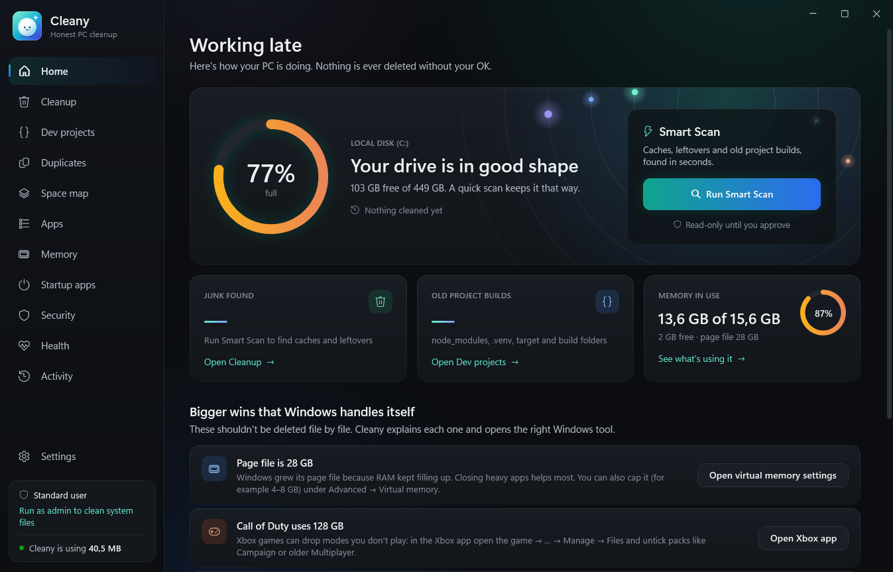
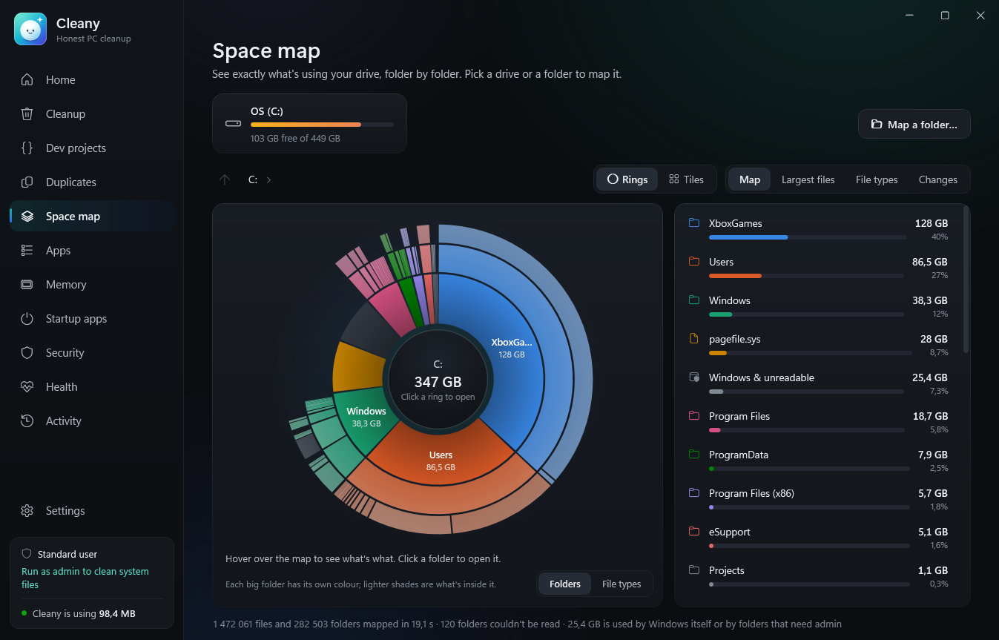

### Hey, I'm Mershlin 👋

I'm a software engineer in Durban, South Africa. I spent about ten years in enterprise IT keeping other people's systems alive, and now I build my own: trading systems, AI products, and tools for Windows.

I like software that's honest about what it does, measured rather than guessed, and quiet in production. I also build for clients, so if you've got something in mind, [skip to the bottom](#work-with-me).

  

---

#### Lately: Cleany

A Windows cleaner and PC guardian I wrote in C# on .NET 10. It maps a whole drive by reading the NTFS file table directly (2.3 million files in about 13 seconds), runs security and health checks on top of Microsoft Defender, and has a game mode that keeps Call of Duty smooth while everything else keeps running. Minimized, it uses about 4 MB of RAM. It never deletes anything without showing you first.

<table>
  <tr>
    <td width="50%"></td>
    <td width="50%"></td>
  </tr>
</table>

#### Trading

- **GhostZero.** My own TradingView indicators, wired to MetaTrader 5 bots for Nasdaq and gold, with Telegram alerts.
- **Deriv Edge Lab.** A research setup for Deriv's synthetic indices that records every tick and proves the data is clean before any strategy is trusted with it.
- **Apex Sentinel.** A live scanner for MEXC futures that ranks coins and flags setups as they form.
- **The Big Green Candle.** A trading education platform with a live market dashboard.

#### AI products

- **AlphaShop.** A South African marketplace where AI agents do the selling: they price, list, find buyers and negotiate.
- **Tenderflow.** Watches South African government tender portals every day and helps put the bids together.
- **Apex Nexus.** A clean chat interface that streams decentralized inference from Bittensor.
- Also in the works: **Agent Workforce Academy** (an AI business school), **BioHack** (a daily health companion) and **Knowdown** (live one-on-one trivia duels).

#### Open source

- **[Tactical Matrix](https://github.com/Mershblizzard/tactical-matrix-sim).** A 3D drone swarm simulator: a Python pathfinding engine streaming over WebSockets into React Three Fiber.

---

#### How I like to build

- **Measure first.** When Cleany's idle window turned out to be using 21% of a CPU core, I traced it to an animation nobody could see and brought it under 1%.
- **Make it safe to trust.** Nothing gets deleted, traded or changed without a check I can explain.
- **Prove the data.** Before a strategy goes anywhere near real money, the ticks behind it get verified.

#### Tools I reach for

Plus MetaTrader 5, TradingView, WebSockets, MCP servers and Bittensor.

---

#### Work with me

I take on freelance and contract work. The kind of thing I'm good for:

- **Trading automation.** MT5 and TradingView bots, scanners and dashboards, built on data you can check.
- **AI products.** From an idea on a napkin to something people actually use: agents that do real work, chat products, MCP integrations.
- **Web apps.** React and Next.js on the front, Python and FastAPI behind it, live data over WebSockets.
- **Windows tools.** Fast, light desktop apps in C# that feel at home on the system.

What working with me looks like: you see something running early, you get updates in plain English, and you own the code at the end.

If that sounds useful, tell me what you're trying to build: [LinkedIn](https://www.linkedin.com/in/mershlin-moodley-a6b43673) or [mershlin@gmail.com](mailto:mershlin@gmail.com).

#### Off the clock

Usually reading charts, or getting humbled in Call of Duty.
